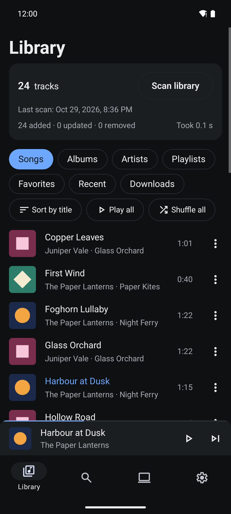
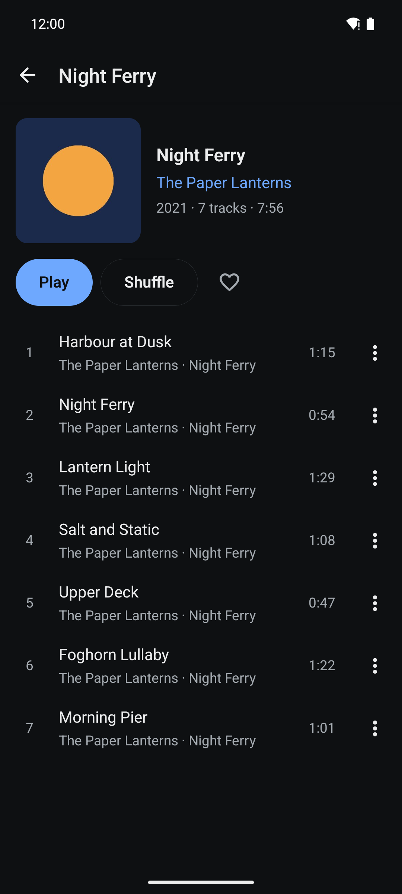
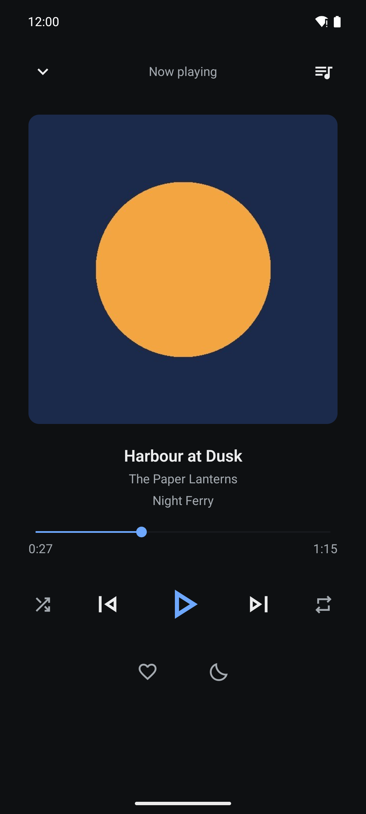
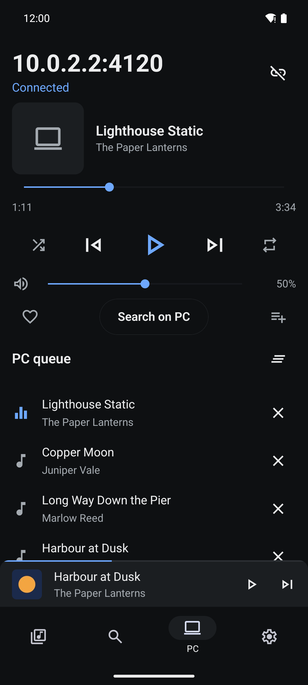

# Aulos

An open-source, offline-first music player for Android. It plays the music already on your phone and
works with no network at all; when you want more, it streams and downloads free music from the
[Internet Archive](https://archive.org) and remote-controls [Nuclear](https://github.com/nukeop/nuclear)
on your PC. No accounts, no tracking, no analytics.

<p>
  
  
  
  
</p>

## Features

- **Your library, offline.** MP3, FLAC, M4A/AAC, Ogg and Opus from the phone's storage; choose which
  folders count. Browse by songs, albums and artists, and search instantly with accents ignored in
  every script (Greek tonos included).
- **Player.** Queue, shuffle, repeat, gapless playback, sleep timer; background playback with
  notification, lock-screen and Bluetooth controls.
- **Collections.** Playlists with drag-to-reorder and JSON import/export, favourite tracks, albums
  and artists, listening history.
- **Internet Archive.** Search, stream and download public-domain and Creative Commons audio
  (MP3, FLAC or Ogg). Downloads resume after a restart, can be limited to Wi-Fi and to a storage
  budget, and play in airplane mode.
- **Nuclear on your PC.** Find Nuclear on your Wi-Fi or type its address (Tailscale works too); a
  live remote with play/pause, skip, seek, volume, shuffle, repeat and favourite; the PC's queue,
  search on the PC, "Send to PC" for a phone track, and import of playlists exported from Nuclear.
- **Private.** The only network traffic is to the Internet Archive (HTTPS) and to your own PC.

More screenshots: [albums](docs/screenshots/2-albums.png), [search](docs/screenshots/5-search.png),
[settings](docs/screenshots/7-settings.png).

## Install

Download the APK from [GitHub Releases](https://github.com/Fiouri/aulos/releases). Android 7.0
(API 24) or newer.

| APK                               | For                                                                    |
| --------------------------------- | ---------------------------------------------------------------------- |
| `aulos-<version>-arm64-v8a.apk`   | Almost every phone from the last eight years. Pick this one if unsure. |
| `aulos-<version>-armeabi-v7a.apk` | Older 32-bit phones.                                                   |
| `aulos-<version>-x86_64.apk`      | Emulators and x86 Chromebooks.                                         |
| `aulos-<version>-universal.apk`   | Any device; larger, because it holds all three.                        |

To find your phone's type: `adb shell getprop ro.product.cpu.abi`, or an app such as
"Device Info". Installing an ABI APK over the universal one (or the other way round) keeps your
data; Android only refuses an update signed with a different key.

### Verify the download

1. Check the SHA-256 checksum against `SHA256SUMS.txt` from the same release:

   ```bash
   sha256sum -c SHA256SUMS.txt --ignore-missing          # Linux, macOS (shasum -a 256 -c)
   ```

   ```powershell
   Get-FileHash .\aulos-1.0.0-rc.1-arm64-v8a.apk -Algorithm SHA256   # Windows
   ```

2. Check the signing certificate with `apksigner` from the Android SDK build-tools:

   ```bash
   apksigner verify --print-certs aulos-1.0.0-rc.1-arm64-v8a.apk
   ```

   The `certificate SHA-256 digest` must be the fingerprint published in
   [RELEASING.md](RELEASING.md#signing-certificate). Any other key means the APK is not an official
   build.

## Pair with Nuclear

Aulos talks to Nuclear through **Nuclear Jam**, the HTTP API that Nuclear's own browser remote uses.

1. In Nuclear on the PC, turn on **Nuclear Jam** in Settings. Settings → Integrations then shows the
   API address, for example `http://192.168.1.42:4120/api`.
2. On the phone, open the **PC** tab. On the same Wi-Fi, tap **Find PCs on Wi-Fi**; or type the PC's address
   (`192.168.1.42`, or `192.168.1.42:4121` if Jam uses another port in 4120–4129) and connect.
   The PC is saved, and the PC tab reconnects to it next time.
3. **Security notice.** Nuclear Jam has no password: anyone on the same network can control the PC
   player. Aulos shows this once when you first pair. Keep Jam reachable on trusted networks only:
   - In Windows Defender Firewall, allow Nuclear on **Private** networks only (untick _Public_ in
     the prompt Windows shows on first start, or under _Allow an app through Windows Firewall_).
     An equivalent explicit rule, from an administrator PowerShell:

     ```powershell
     New-NetFirewallRule -DisplayName "Nuclear Jam (private networks)" -Direction Inbound `
       -Protocol TCP -LocalPort 4120-4129 -Profile Private -Action Allow
     ```

   - Make sure your home Wi-Fi is set to _Private_ in Windows, and turn Jam off on public Wi-Fi.
4. **Away from home: Tailscale.** Install [Tailscale](https://tailscale.com) on the PC and the
   phone, then enter the PC's Tailscale address (`100.x.y.z`) or its MagicDNS name
   (`my-pc.tail1234.ts.net`) in the PC tab. Tailscale encrypts the traffic, which Jam itself does
   not. Windows usually puts the Tailscale adapter in the _Public_ profile, so the Private-only rule
   above does not cover it; allow Jam for Tailscale addresses only:

   ```powershell
   New-NetFirewallRule -DisplayName "Nuclear Jam (Tailscale)" -Direction Inbound `
     -Protocol TCP -LocalPort 4120-4129 -RemoteAddress 100.64.0.0/10 -Action Allow
   ```

   Wi-Fi discovery does not work while a VPN is on in the phone; type the address instead.

Aulos only sends plain HTTP to private addresses (LAN, Tailscale `100.64.0.0/10`, `*.ts.net`,
link-local); everything else must be HTTPS.

**Importing Nuclear playlists.** Export a playlist from Nuclear, then share the file to Aulos or
pick it with **Import playlist** in Library → Playlists. Tracks that are on the phone (or downloaded) are
matched; the rest stay greyed as "Not on this phone". Importing the same playlist again adds what
is new and never removes anything.

## Known limitations

- **Background downloads.** Downloads pause when Aulos is in the background without playing
  music, and resume when you return to it. A download service is planned for v1.1.
- **Android only.** There is no iOS version.
- **English only.** Every string goes through i18n, so translations can be added later.
- Nuclear Jam has no authentication (see above), and cannot send the PC's playlists to the phone
  on its own: use Nuclear's playlist export.

## Build from source

Requirements: Node.js 22, npm, JDK 17 (Temurin), the Android SDK. Builds are local; Expo Go and
EAS are not used. `android/` is generated by prebuild and not committed.

```bash
npm ci
npm run typecheck && npm run lint && npm test -- --ci
npm run android:prebuild                        # regenerates the licence list, then android/
cd android && ./gradlew lint assembleRelease -Paulos.unsignedRelease=true
# APKs: android/app/build/outputs/apk/release/app-{arm64-v8a,armeabi-v7a,x86_64,universal}-release-unsigned.apk
```

On Windows use `.\gradlew.bat`. Without `-Paulos.unsignedRelease=true` the release build expects the
signing properties described in [RELEASING.md](RELEASING.md) and stops with a message if they are
missing; it never falls back to a debug key. For development on a device: `npx expo run:android`.

Tests on a device or emulator use [Maestro](https://maestro.mobile.dev):

```powershell
.\scripts\test-media.ps1 -Mode standard          # test albums (Greek, gapless FLAC, two discs) via adb
node scripts/mock-jam.ts                          # a fake Nuclear Jam for the PC flows on an emulator
maestro test -e EXPECTED_TRACKS=<music count> .maestro/
.\scripts\test-media.ps1 -Mode clean              # removes the test music again
```

`test-media.ps1` needs ffmpeg and adb on PATH. See [SPEC.md](SPEC.md) for the design and
[CHANGELOG.md](CHANGELOG.md) for releases. Security reports: [SECURITY.md](SECURITY.md).

## Licence

Aulos is free software, licensed under the **GNU General Public License, version 3 or later**
(GPL-3.0-or-later). See [LICENSE](LICENSE). The app icon is original artwork drawn in
`scripts/render-icons.ts` and is under the same licence. Third-party packages and their licences
are listed in the app under Settings → Third-party licences.
